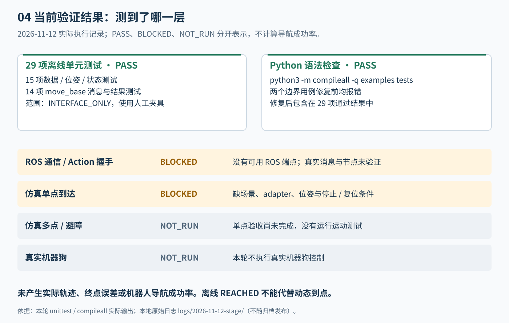
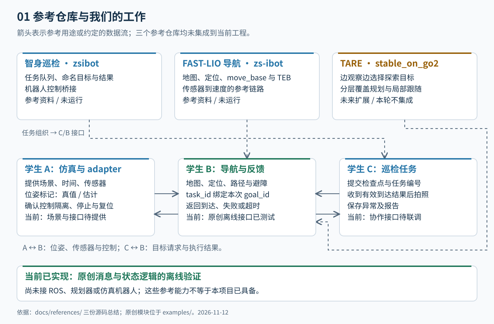

# 机器狗二维路面巡检

光明实验室《二维路面巡检学生任务书》学生 B 的工程记录。目标是在平地沿路线移动，到井盖检查点停下，由学生 C 拍照检查，并记录沿途异常。项目周期为 **2026-10-26—2027-01-17**，本仓库实际工作记录始于 **2026-11-12**，没有回填前两周实验。

**截至 2026-11-13，B/C 离线接口联调通过，完整测试 66 项通过；单点导航尚未完成动态验证。** 没有实际轨迹、终点误差或导航成功率。范围限二维平地，不做楼梯、机械臂或行走策略训练。

| 成员 | 职责 |
| --- | --- |
| A | 仿真场景、机器人与传感器、adapter、停止与复位 |
| **B（本仓库）** | **地图、定位、规划、避障、目标执行及状态反馈** |
| C | 巡检任务、拍照检测、异常与报告 |

协作约定：C 提交检查点 → B 导航 → A 的 adapter 执行并反馈位姿 → B 返回移动结果 → C 开始检查。C→B→C 已用实际 PatrolRunner 和人工导航反馈离线验证；A 的动态链路尚未接通。

## 11 月 13 日接口交接

- [B/C 接口 v1](docs/interfaces/b-c-interface.md)：同步 navigate、四项业务 ID 与独立 goal_id、超时及取消边界。
- [给 C 的九项回复](docs/handoffs/reply-to-c.md)与[待确认事项](docs/handoffs/questions-to-c.md)。
- [A/B 仿真接口 v1](docs/interfaces/a-b-interface.md)与[A 的 P0/P1/P2 回复模板](docs/handoffs/questions-to-a.md)。
- [实际测试报告](docs/handoffs/validation-2026-11-13.md)：原29项＋21项契约＋13项真实C流程＋3项合成字段，全部为 INTERFACE_ONLY。

新增 `examples/c_patrol_adapter.py`、`c_patrol_demo.py` 和对应测试。C 的原始工程在仓库之外，B 没有复制其检测代码、图片或报告。真实 C 集成测试需要已审核的 C project 与已有 Pillow：

```bash
export C_PROJECT_ROOT=/path/to/C/project
python3 -m unittest discover -s tests -v
python3 -m examples.c_patrol_demo --samples
python3 -m examples.c_patrol_demo --c-project "$C_PROJECT_ROOT" --output logs/new-bc-run --scenario success
```

替换 C 路径；未设置时 13 项 C 集成测试会跳过，不能算作全套通过。A/B 字段样例在 `examples/ab_simulation_contract.json`，全部为 SYNTHETIC_EXAMPLE。

从已验证提交生成两份独立交接包（只含B原创文件，不覆盖旧ZIP）：

```bash
python3 tools/build_handoffs.py --output-dir /home/student2/exports --c-project "$C_PROJECT_ROOT"
```

构建器记录提交、日期、版本与包内测试结果，并解压复测。当前最重要的后续输入是 A 的隔离场景、位姿/控制和停止复位方法。

## 已完成与尚未完成

下图和三个条目保留 **11 月 12 日的29项测试基线**；本轮新增结果以上面的交接报告为准。



- `interface_demo.py`：验证请求、位姿、坐标系、超时和到达判据，输入为人工测试数据。
- `move_base_adapter.py`：填写目标消息字段，按实际 goal_id 关联结果，区分取消请求与确认；没有 ROS 通信或控制发布。
- 本轮修复超大整数和极端角度造成的异常；保留原有 27 项测试，增加 2 项复现测试。详见[阶段总结](docs/project-progress.md)。

## 代码与复现

工作目录为 `/home/student2/projects/machine-dog`；参考快照位于同级 `machine-dog-references`，不随成果发布。

```text
README.md / .gitignore
docs/
  project-progress.md          # 工作过程、问题与当前结果
  references/                 # 三份参考仓库总结
  figures/                    # 四张 SVG 图
  reference-audit.md           # 首轮源码证据及许可记录
  week01-02.md / week03-04.md   # 启动说明 v0、接口和历史验收
examples/
  interface_demo.py / move_base_adapter.py
  c_patrol_adapter.py / c_patrol_demo.py / ab_simulation_contract.json
tests/
  test_*.py                    # 原29项、B/C契约、真实C流程及A/B字段
tools/build_handoffs.py         # 从Git提交打包并解压复测
```

已验证环境：Ubuntu 22.04.5、Python 3.10.12、Git 2.34.1。原创代码仅用 Python 标准库，不需要安装 ROS 或使用 GPU。仓库根目录运行：

```bash
python3 -m unittest discover -s tests -v
python3 -m compileall -q examples tests
python3 examples/interface_demo.py --scenario reached
python3 examples/interface_demo.py --scenario failed
python3 examples/interface_demo.py --scenario timeout
```

三个示例均标记 `INTERFACE_ONLY`、`SYNTHETIC_FIXTURE`，位姿来源 `UNKNOWN`。输出 REACHED 仅表示输入的测试位姿符合容差，不代表机器人运动。适配器由测试调用，没有独立的导航启动命令。

## 阅读入口

| 内容 | 文件与范围 |
| --- | --- |
| 智身巡检，`zsibot` | [任务、导航结果与机器人桥接](docs/references/01-elevator-robot.md) |
| FAST-LIO 导航，`zs-ibot` | [地图、定位、全局规划与 TEB](docs/references/02-fastlio-navigation.md) |
| TARE，`stable_on_go2` | [自主探索的目标选择与路径跟随](docs/references/03-cmu-tare.md)，未来扩展 |
| 个人阶段工作 | [过程、代码用途、问题与测试](docs/project-progress.md) |
| 历史记录 | [首轮审计](docs/reference-audit.md)、[第 1–2 周](docs/week01-02.md)、[第 3–4 周](docs/week03-04.md) |



另见[参考导航链路图](docs/figures/02-navigation-flow.svg)和[目标状态图](docs/figures/03-goal-state.svg)。全部来自源码或离线测试证据，没有仿真动画或实机录像。

## 接下来缺什么

当前可见环境未找到可用 ROS、仿真场景和已验证 adapter；不能据此断言实验室其他环境不存在。GPU 在第二轮查询中可用，历史检查范围见第 3–4 周记录。

A 需要提供获准使用的现成环境、平地场景、位姿/传感器接口、独立控制端点及停止/复位方式。B 随后接真实 ActionClient，核实全局插件和 `/odom` 来源，先验证单点，再做多点与避障。C 需要确认导航失败时如何暂停检查、重试和关联任务。

本仓库是原创说明、示例与测试，不包含参考仓库实现、内部地图、模型或控制凭据。第三方许可按组件记录，尚未擅自添加本项目许可证。
