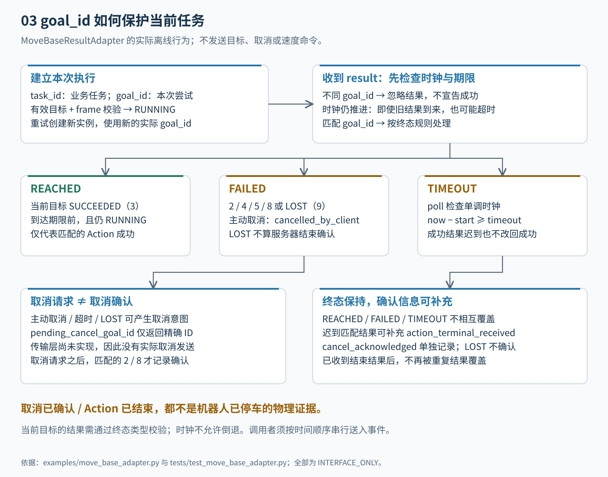

# 学生 B 阶段总结：目前做到了哪一步

记录日期：**2026-11-12，Asia/Shanghai**。本轮复核了原有提交和测试，补读参考源码并修复两个边界问题。**单点导航尚未完成动态验证。** 本文中的“我”指学生 B 的工程工作，不代表已经操作过真实机器狗。

## 职责与环境

项目要让机器狗沿平地路线巡检。我负责地图、定位、路径规划、避障及移动结果，A 提供场景和 adapter，C 负责检查任务与检测。

连接 Ubuntu 工作站、安装并登录 Codex 是开始前由本人提供的条件，没有对应安装日志，不能补记为本轮操作。实际命令确认可以访问 student2 的独立工程。环境为 Ubuntu 22.04.5、Python 3.10.12；第二轮 GPU 查询成功识别 RTX 4090。此前 GPU 查询失败的隔离原因仍未查明，没有修改驱动。[环境检查记录](week03-04.md)保留了命令范围与限制。

## 工作是怎样推进的

| 顺序 | 实际工作与依据 |
| --- | --- |
| 1 | 在独立目录保存参考快照与原创工程，避免改动共享源码。未把整仓参考代码带入成果仓库 |
| 2 | 阅读指定分支的启动、配置和源码，记录 SHA 与许可；梳理点云/IMU、地图、位姿、规划和控制接口。TARE 首轮只查用途与许可，本轮才补读探索算法 |
| 3 | 编写单点离线接口，区分 RUNNING、REACHED、FAILED、TIMEOUT。`8b5f5bc`（17:38）保存基线和 13 项测试 |
| 4 | 发现巡检客户端既可能“发出目标就返回成功”，也可能接收旧目标的成功结果。离线提取相关方法，用 old-goal 的结果复现后一个问题 |
| 5 | 写消息/结果适配器，使用 goal_id 区分每次执行，增加取消、超时和终态测试。`0f531599`（18:40）保存 27 项通过结果与环境检查 |
| 6 | 检查 ROS、仿真入口与 GPU，确认当前没有可接入的场景/端点。未启动控制桥接或运动测试；这一步与上一步属于同一轮，不伪造更细的实验顺序 |
| 7 | 本轮重新运行 27 项测试，再扩展三仓库主流程阅读。新增两个数值边界测试，先复现异常，再修复；当前共 29 项通过 |

所有工作发生在 11 月 12 日，不回填任务书 10 月 26 日至 11 月 8 日的实验。

## 当前文件与代码作用

```text
machine-dog/
├── README.md / .gitignore
├── docs/
│   ├── project-progress.md
│   ├── reference-audit.md / week01-02.md / week03-04.md
│   ├── references/  (01-elevator-robot、02-fastlio-navigation、03-cmu-tare)
│   └── figures/     (四张 SVG)
├── examples/        (interface_demo.py、move_base_adapter.py)
└── tests/           (test_interface_demo.py、test_move_base_adapter.py)
```

| 文件 | 实际作用与调用方式 |
| --- | --- |
| [interface_demo.py](../examples/interface_demo.py) | 定义请求、位姿和反馈；`step` 检查时间/坐标系与位置、朝向容差。CLI 的 reached/failed/timeout 仅输入人工夹具 |
| [move_base_adapter.py](../examples/move_base_adapter.py) | `make_move_base_goal` 填目标字段；`MoveBaseResultAdapter` 处理匹配结果、期限和取消意图。只由调用方/测试驱动，没有 ROS 节点 |
| [test_interface_demo.py](../tests/test_interface_demo.py) | 15 项：有效/无效输入、无位姿、旧时间、角度跨界、到达及终态、两个数值边界 |
| [test_move_base_adapter.py](../tests/test_move_base_adapter.py) | 14 项：消息字段、旧 goal_id、成功/失败、超时、取消请求/确认、LOST 与异常输入；使用替代消息对象，不是 ROS 握手测试 |
| README / .gitignore | 阅读与运行入口；排除构建、缓存、凭据和大型数据 |
| references / figures | 各仓库的主流程与准确路径；四图用于展示参考关系、导航链路、状态和验证范围 |
| 首轮审计 / 两份周记录 | 保留原日期、13/27 项测试及问题复现证据，不改写为本轮结果 |

## 问题、修改与验证

| 问题 | 发现方式与原因 | 处理及当前状态 |
| --- | --- | --- |
| 旧目标误报成功 | 参考 `_result_cb` 未核对 ID；输入 old-goal 成功可误报当前任务 | 原创适配器精确匹配；测试 PASS。参考部署和真实 ROS 均未修复/验证 |
| 超时后收到成功、取消与停车混淆 | 状态测试注入迟到结果/取消确认 | 终态不覆盖；确认字段独立，取消仅是意图。离线 PASS，物理停车未测 |
| 超大整数异常类型不一致 | 新测试传入 `10**1000`，`math.isfinite` 抛 OverflowError | `_finite` 转为约定的 ValueError；修复前 ERROR，修复后 PASS |
| 有限大角度计算崩溃 | `1e308 - (-1e308)` 溢出后调用 sin | 先分别按周期归一化再相减；修复前 ERROR，修复后 PASS。只是数值健壮性，不是传感器精度验证 |
| 实际全局规划器不明 | 有 GlobalPlanner 参数，但 launch 未选插件 | 标为按标准默认机制推断 Navfn/Dijkstra；等运行时核实 |
| 无法做动态导航 | 无已验证场景、ROS 端点、停止与复位方法 | BLOCKED；未安装整套仿真或绕过环境隔离 |



task_id 关联 C 的业务任务；goal_id 区分每次实际发送。重试应创建新实例并使用实际 Action goal_id。模块本身不发送目标，也不负责线程调度。它返回 REACHED 的依据是匹配成功结果，真实联调仍要核对机器人终点位姿。

## 本轮实测与证据

仓库根目录执行 `python3 -m unittest discover -s tests -v`：**29 项 PASS**；`python3 -m compileall -q examples tests`：**PASS**。三种 CLI 场景也可运行，全部为 **INTERFACE_ONLY**，人工位姿标记 UNKNOWN。ROS/仿真单点为 **BLOCKED**；多点、避障、真机为 **NOT_RUN**。[验证图](figures/04-verification.svg)不是导航成功率图。

本地证据在 `logs/2026-11-12-stage/`：`boundary-before.txt` 为修复前两项报错，`unittest.txt`、`compileall.txt` 为复测，`verification.json` 供验证图取数。此前的 `logs/2026-11-12-navigation/` 保留旧结果复现与环境输出。日志和渲染预览被 Git 排除；归档接收者可直接重跑测试，没有依赖这些日志。

没有找到现成运行录像；终端录屏会重复测试输出，因此本轮只保留四张 SVG，没有制作导航视频。

## 工程取舍与下一步

FAST-LIO、NDT、TEB 和 TARE 都是参考能力，没有集成进当前项目。已有框架提供了地图、规划和控制接口，眼下重写它们不能解决缺场景的问题。先把结果关联说清楚，是为了避免 C 在机器狗还没到点时开始检查。

下一步需要 A 提供获准使用的环境路径、场景、位姿/传感器/TF、时间来源、隔离控制接口和停止/复位命令。B 再接 ActionClient 的发送与单目标取消，核实 `/odom` 和实际插件，完成一次带起终点、轨迹和时间记录的单点导航；成功后再测 3–5 点与障碍。C 需确认失败后的检查暂停和重试规则。当前尚不能进入仿真运动联调。
