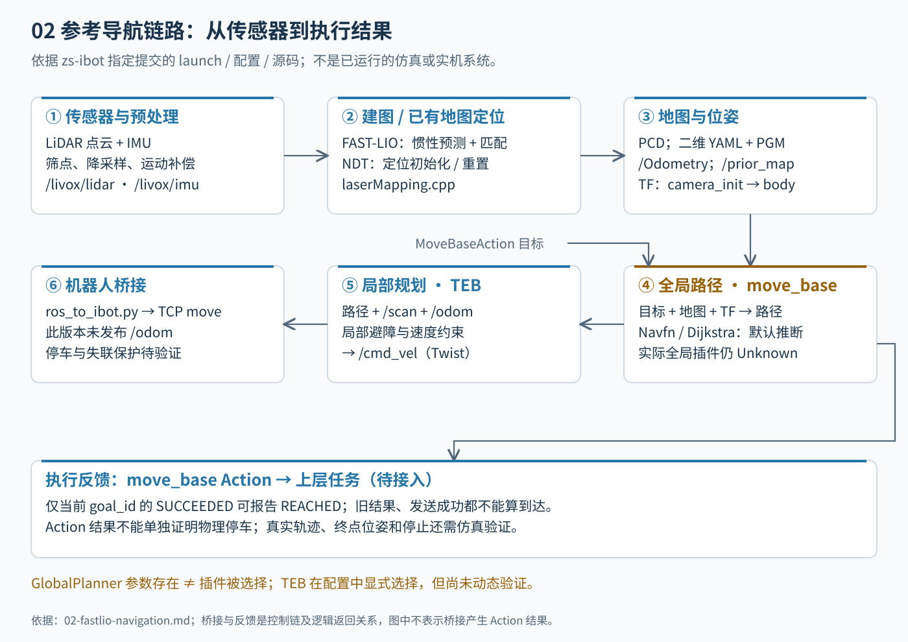

# 02｜FAST-LIO 导航：地图、位姿和速度从哪里来

## 版本与阅读范围

[仓库 zs-ibot 分支](https://github.com/G-SEI-Lab/fastlio_navigation_2d/tree/zs-ibot)，本次核对提交 `fee12f4f83d932466254a724cd5800bfb9981861`（2026-11-12）。本地是原始文件快照，没有 `.git`；保存文件已对照该提交目录树校验 Git blob 哈希。

已读 README、manifest/CMake、当前启动链及配置、点云/IMU/滤波/地图主要函数、ikd-Tree 接口和智身桥接。没有逐行审计全部数学工具、运行外部 ROS 插件或加载现场地图。所有算法运行效果仍未验证。

## 它解决什么问题

这个 ROS1 工程先用激光雷达和惯性测量单元（IMU）估计机器人在哪里，再把地图与位姿交给二维导航。导航规划出路径，并计算下一步速度。它是学生 B 最直接的技术参考，但当前项目没有把它编译、接入或运行成功。

## 核心模块与目录

| 模块 | 作用 | 输入 → 处理 → 输出 | 关键文件/入口 |
| --- | --- | --- | --- |
| 传感器预处理 | 让点云与运动数据可用于匹配 | `/livox/lidar`、`/livox/imu` → 筛点、降采样、运动补偿 → 补偿点云 | `src/preprocess.cpp::Preprocess::process`、`src/IMU_Processing.hpp::Process/UndistortPcl`；`config/` 定义传感器和外参 |
| FAST-LIO 建图 | 持续估计位姿并积累地图 | 点云+IMU → 惯性预测、地图匹配与滤波 → `/Odometry`、TF、注册点云 | `src/laserMapping.cpp::h_share_model/publish_odometry/map_incremental`；`include/use-ikfom.hpp` 定义状态模型 |
| 已有地图定位 | 在预存地图内确定位置 | `PCD/<map_name>.pcd`、`/initialpose`、传感器 → 初始对齐后继续滤波 → 位姿 | 同一源码的 `loadPcdToIkdtree/ndtRegistration`；`config/localization_mid360.yaml` |
| 二维地图与障碍 | 给规划器可走区域和障碍信息 | 注册点云 → OctoMap 投影/激光切片 → `/projected_map`、`/scan` | `launch/Pointcloud2Map.launch`、`launch/PointsCloud2toLaserscan.launch`；已有 YAML/PGM 由 map_server 加载 |
| 全局/局部导航 | 先选整条路，再计算眼前怎么走 | 目标、地图、TF、`/odom` → 全局路径+局部轨迹 → `/cmd_vel` Twist | `launch/sentry_movebase_teb.launch`；`param/teb/` 定义插件、代价地图、速度和容差 |
| 智身桥接 | 将速度交给机器人服务 | `/cmd_vel` → JSON move；查询状态 → String 话题 | `scripts/ros_to_ibot.py::RobotBridgeNode`；该版本没有 `/odom` 发布器 |

`shell/mapping/` 和 `shell/navigation/` 是人工分步启动入口。`CMakeLists.txt` 将 `laserMapping.cpp`、预处理和 ikd-Tree 编为 `fastlio_mapping`；ROS 包名是 `fast_lio`，不是目录名。

## 算法怎样工作，实际启用了什么

| 算法/组件 | 输入 → 主要处理 → 输出及用途 | 状态 |
| --- | --- | --- |
| **FAST-LIO**：激光与惯性融合定位建图 | IMU 先预测运动；对补偿后的点云，在 ikd-Tree 中找邻近地图点、拟合局部平面，用误差反复修正滤波状态；输出位姿，建图模式再加入新点。类似用惯性估计“走了多少”，再用墙面等几何结构纠偏 | 仓库有实现，建图/定位 launch 均调用；未动态验证 |
| **NDT**：正态分布变换配准 | 当前点云+旧地图+初始猜测 → 用地图网格内的统计分布寻找较匹配的变换 → 初始位置和方向。代码在需要初始化/重置时调用，之后不是每帧只跑 NDT | `ndtRegistration` 被定位分支调用；未动态验证 |
| **全局规划** | 起点/目标+栅格代价 → 搜索代价较小的路线 → 全局路径 | launch 未设置 `base_global_planner`。按标准 move_base 默认机制推断为 **Navfn/Dijkstra**；实际插件 Unknown |
| **TEB**：带时间的弹性轨迹优化 | 全局路径、障碍与速度 → 调整局部位姿和时间间隔，同时考虑障碍距离与运动约束 → 速度指令 | 外部插件；当前 YAML 明确选择 `teb_local_planner/TebLocalPlannerROS`，不代表已运行 |

`GlobalPlanner.use_dijkstra=true` 只是参数，**没有选择插件就不能证明 GlobalPlanner 在工作**。依据是本仓库 launch 和官方 [move_base 默认插件](https://github.com/ros-planning/navigation/blob/noetic-devel/move_base/src/move_base.cpp)、[Navfn 调用](https://github.com/ros-planning/navigation/blob/noetic-devel/navfn/src/navfn_ros.cpp)。TEB 原理参考其[上游说明](https://github.com/rst-tu-dortmund/teb_local_planner)。`param/mpc/` 等备选文件不在本次启动链中。

## 从启动到结果

建图链：`shell/mapping/1-mid360 → 2-mapping → sentry_build_map.launch → mapping_mid360_no_rviz.launch`。注册点云可投影成二维地图；`map_saver` 保存 YAML+PGM，建图退出时另存二进制 `PCD/scans.pcd`。

已有地图导航链：`shell/navigation/1-mid360 → 2-localization → 3-planning-teb → 4-cmd-to-go2-teb`。最后一个名字虽带 go2，实际调用 `ros_to_ibot.py`。定位读取 PCD；map_server 输出 `/prior_map`，move_base 的地图输入相应重映射。目标使用 MoveBaseAction 或 `/move_base_simple/goal`，结果由 Action 返回，不能以“发布成功”判定到达。

TF（坐标系变换）为 `map → camera_init → body → body_foot`。Odometry 的位姿是 `camera_init/body`，动态 TF 则把高度和姿态投影到平面；雷达 body 与底盘 body_foot 也不能混用。`/Odometry` 是滤波输出，TEB 配置需要的 `/odom` 是另一个话题。

以上入口只做代码追踪，未执行。依赖 ROS1/catkin、C++14、Eigen/PCL、Livox、move_base、TEB、OctoMap 等；不能在 Ubuntu 22.04 上直接假设这些组件已齐备。

## 对我们有用的部分与待确认项

B 应复用现有定位/地图与 move_base+TEB 体系，把精力放在地图坐标、目标状态和 A 的 adapter 上。早期可接 A 已验证的真值位姿，但必须标 `GROUND_TRUTH`，不能算 FAST-LIO 验证通过。

接入前重点核对：driver2 启动与 driver1 CustomMsg 是否兼容、成对地图是否同源、实际全局插件、`/odom` 发布者、底盘限速与失联停车。此桥接的超时置零不能保证断网时真正停下；巡检仓库的较新客户端才有速度填充 `/odom` 的代码。

根 LICENSE 为 GPL v2，package.xml 和部分源码另有 BSD 声明，适用范围需进一步确认。本轮不合并源码。具体配置和风险证据保留在 [首轮审计](../reference-audit.md)。
